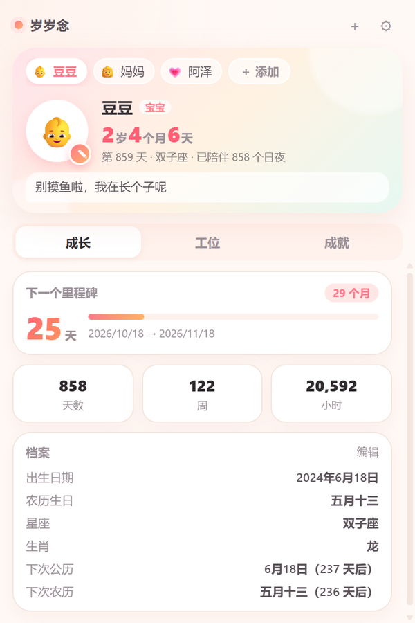
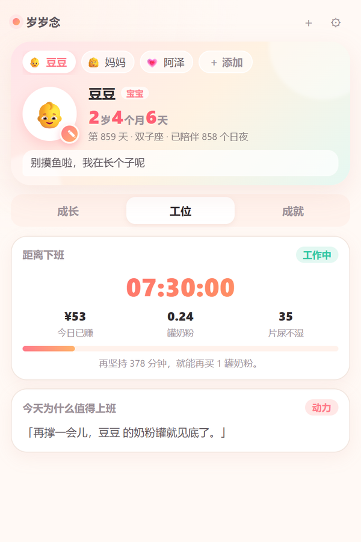
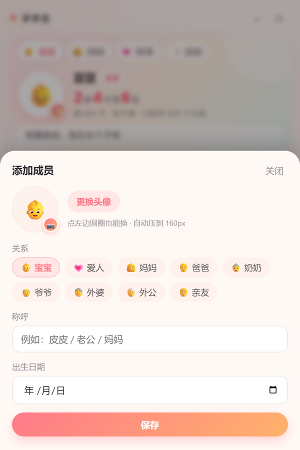
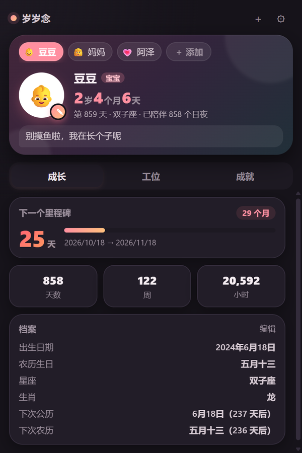

# 岁岁念

一个记着家人、也记着自己为什么上班的 Chrome 扩展。

它记录每位家人的生日与年岁，把「还有多久下班」和「今天赚了几罐奶粉」摆在眼前 —— 上班打开扩展，第一眼看到的是下班倒计时和家人的一句叮嘱。所有数据都存在本机 `chrome.storage.local`，不联网、不上传。

## 界面

<p align="center">
  
  
  
</p>
<p align="center">
  
  
</p>

<sub>截图使用演示数据（豆豆 / 妈妈 / 阿泽），不含任何真实信息。</sub>

## 家人

- 一个扩展管全家人。每位成员有称呼、关系、出生日期和头像
- 关系：宝宝 / 爱人 / 妈妈 / 爸爸 / 奶奶 / 爷爷 / 外婆 / 外公 / 亲友
- 按关系分流展示：
  - 宝宝 —— `x岁x个月x天`、第 N 天、整月 / 百天 / 1000 天 / 周岁里程碑
  - 大人 —— `x岁x个月`、`还有 N 天生日`、下次生日 / 下一个整十岁
- 台词池随关系切换：宝宝撒娇、爱人叮嘱（“别熬太晚，我等你一起吃饭”）、长辈关心（“工作别太拼，身体要紧”）
- 头像有四个入口：英雄区头像右下角的 ✎、档案里的「编辑」、弹层里的圆形头像、「更换头像」按钮
  - 选图后自动裁成正方形、压到 160×160 JPEG（通常几 KB），点「保存」才写入

## 成长

- 精确年龄 `x岁x个月x天`：先估月份再用锚点日期回退，月末、闰年、2 月 29 日都不会算错
- 第 N 天 / 已陪伴天数 / 周数 / 小时数
- 下一个里程碑倒计时：自动挑最近的一个，带进度条
- 星座、生肖（生肖按春节分界，覆盖 2015–2030）
- 下次公历生日、下次农历生日两个倒计时；生日当天自动撒花
- 添加时校验：称呼必填、日期不能晚于今天

## 农历生日与提醒

- 档案里直接显示农历生日，例如「五月十三」；闰月出生显示「闰二月初四」
- 农历生日也是里程碑候选，离得最近就顶到「下一个里程碑」卡片上
- 后台 service worker 每天 09:00 检查一次，农历生日当天和前一天各弹一条浏览器通知，可在设置里关闭
- 农历算法是 1900–2100 的万年历查表（`lunar.js`），**没有**用浏览器内置的 `Intl` 农历：
  - ICU 的 chinese 日历在 2027、2030 等年份会差一天（2027 春节实际 2 月 6 日，ICU 算成 2 月 7 日），而且结果随系统时区漂移
  - 已用 17 个已知日期交叉验证：1900 / 1984 / 2000 / 2010 / 2024 / 2026 / 2027 春节、2023 闰二月、2020 闰四月、2017 与 2025 闰六月、端午中秋等，全部一致
  - 腊月三十出生、当年腊月只有廿九时，自动按「当月最后一天」提醒

## 工位

- 下班倒计时：上班时段打开扩展，默认就落在这一页
- 今日已赚 = 时薪 × 已工作时长占比，并折算成「几罐奶粉 / 几片尿不湿」
- 休息日自动切到「好好陪宝宝」，不算钱
- 每日一句「今天为什么值得上班」

## 互动与成就

- 摸头像：爱心粒子 + 连击计数 + WebAudio 合成的「咯咯」声 + 随机台词，每次 +1 金币（每天上限 40）
- 等级：青铜 → 白银 → 黄金 → 铂金 → 钻石 → 王者养娃人
- 连续陪伴打卡（14 天格子），跨天自动续，断签重置
- 13 个成就徽章，含「一家人」「一大家子」「上有老」，解锁时弹 toast
- 浅色 / 深色主题跟随系统

## 安装

1. 打开 `chrome://extensions/`
2. 右上角开启 **开发者模式**（解压扩展在开发者模式关闭时会被自动停用，表现为「已关闭 · 开启开发者模式即可使用此扩展程序」）
3. 「加载已解压的扩展程序」→ 选中本项目文件夹
4. 点地址栏右侧的拼图图标，把「岁岁念」固定到工具栏
5. 改完代码后，在扩展卡片上点 ⟳ 重新加载

## 数据结构

```js
chrome.storage.local = {
  members: [{ id, name, relation: '宝宝', birthday: 'YYYY-MM-DD', avatar: 'data:image/jpeg;base64,...' }],
  currentId: '...',
  settings: { start: '09:00', end: '18:00', hourly: 35, milkPrice: 220, lunarReminder: true },
  stats: { coins, pets, happiness,
           streak: { count, last, days: [] }, daily: { date, pets }, unlocked: [], flags: {} },
  notified: { 'lunar-<memberId>-<date>': '<date>' }   // 通知去重，最多保留 60 条
}
```

- 早期版本只写 `babies[]`，扩展首次打开会自动迁移成 `members[]` 并补 `relation: '宝宝'`，随后删除旧键，老数据不丢
- 设置页里可以导出 / 导入 JSON 备份

## 权限

只有三个：

| 权限 | 用途 |
|---|---|
| `storage` | 存成员、设置、统计数据 |
| `alarms` | 每天 09:00 定时检查农历生日 |
| `notifications` | 弹生日提醒 |

## 文件

```
test/
├── manifest.json      # MV3 配置
├── popup.html         # 弹窗结构
├── styles.css         # 主题、卡片、动画（浅色 / 深色）
├── popup.js           # 界面逻辑：成员、年龄、工位、互动、设置
├── lunar.js           # 农历：1900–2100 查表 + 生日推算（弹窗和后台共用）
├── background.js      # service worker：定时检查并通知
├── icons/             # icon16 / 32 / 48 / 128
└── README.md
```
